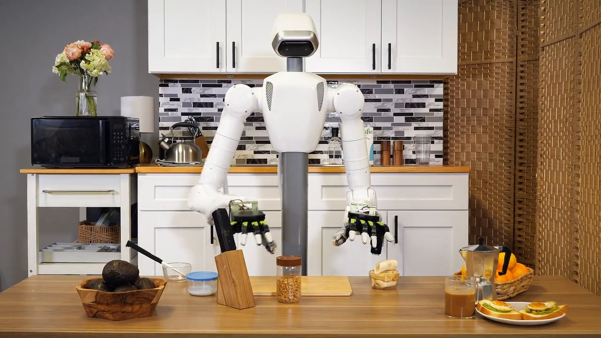
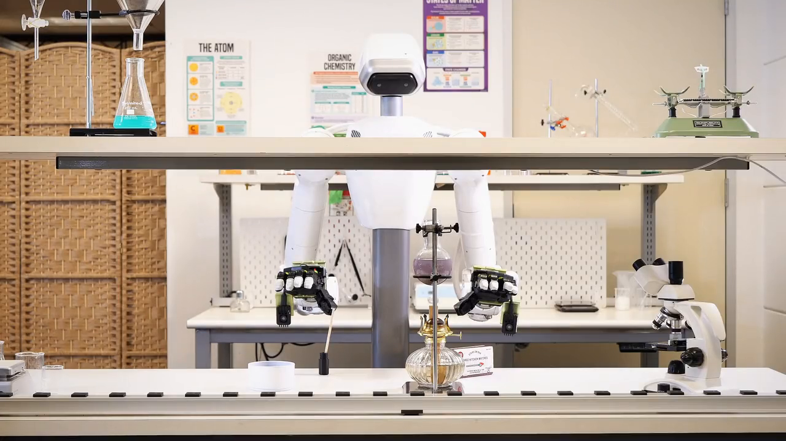
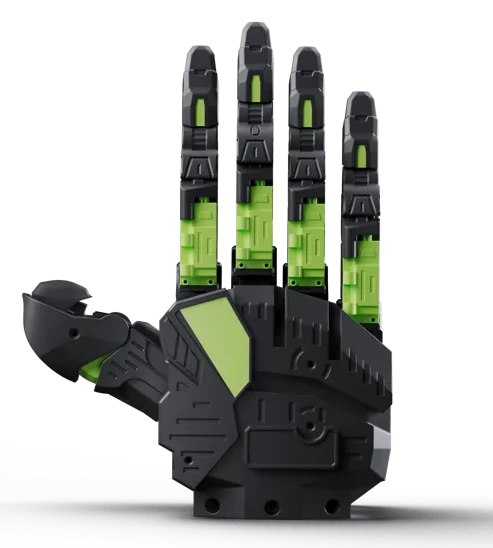

<!--
SPDX-FileCopyrightText: Copyright 2026 Beijing Xingdongjiyuan Co. Ltd.
SPDX-License-Identifier: MIT
-->

# DexUMI Solution Partner - XHAND1 Pro-U

## DexUMI Solution Initiative

RobotEra is developing a scalable DexUMI solution for dexterous manipulation research, covering data collection, policy training and deployment on robot hands.

> **We will share the solution and supporting resources in stages.** Part 1 introduces XHAND1 Pro-U, including the hand’s design, key specifications and complete left- and right-hand URDF models. Further solution resources and integration guides are coming soon.

Explore the open-source tools and research behind the DexUMI workflow.

1. **Collect demonstrations.** [NVIDIA GEAR DexUMI software guide](https://research.nvidia.com/labs/gear/hardware-prototypes/GEAR_DexUMI/software.html) · [Source code](https://github.com/NVlabs/GR00T-DataHardwarePrototypes/tree/main/UMIverse_software/dexumi/data_collection_scripts). Calibration, recording, alignment and export of training datasets.
2. **Train policies.** [DexUMI policy training](https://github.com/real-stanford/DexUMI#%E2%80%8D%EF%B8%8F-policy-training) · [Isaac GR00T fine-tuning](https://github.com/NVIDIA/Isaac-GR00T/blob/main/getting_started/finetune_new_embodiment.md). References for the original DexUMI Diffusion Policy and NVIDIA GR00T N1.7.
3. **Deploy to the hand.** [DexUMI deployment guide](https://dex-umi.github.io/tutorial/deployment.html) · [Upstream XHand policy example](https://github.com/real-stanford/DexUMI/blob/main/real_script/eval_policy/eval_xhand.py). XHand reference implementation; the XHAND1 Pro-U integration guide is coming soon.

[NVIDIA GR00T 2: DexUMI → XHAND1 Pro-U demonstrations](https://research.nvidia.com/labs/gear/gr00t-2/#dexumi) shows policies learned from DexUMI demonstrations running on a Tianji robot with XHAND1 Pro-U hands.

**Make breakfast**

**Strike a match**

Videos: [NVIDIA GR00T 2 research](https://research.nvidia.com/labs/gear/gr00t-2/#dexumi).

> The training and deployment links cover the original DexUMI/XHand stack and GR00T N1.7. NVIDIA’s GR00T 2 research page currently announces code availability in December 2026.

## Part 1 - XHAND1 Pro-U

XHAND1 Pro-U is a five-finger dexterous hand by RobotEra, derived from the XHAND1 Pro platform and designed for DexUMI-based demonstration collection and policy deployment research.

[Project page](https://roboterax.github.io/xhand1-pro-u/) · [Download URDF V1.2](docs/downloads/XHAND1ProU_urdf_V1.2_MIT_compat.zip) · [MIT License](LICENSE)

### Design philosophy

**Glove-driven mechanical design.** The joint configuration and tactile layout are adapted around the motion-capture requirements of the DexUMI glove.

- **Linkage-driven fingertips.** The four non-thumb fingers use distal linkages to make the coupled fingertip structure more compact.
- **Reconfigured thumb.** The thumb position and joint configuration are adjusted to better match glove-captured thumb motion.
- **Key tactile regions.** Tactile sensing is retained at the fingertips and key palm regions, avoiding the central palm area that deforms during grasping.
- **Active lateral palm motion.** An active lateral degree of freedom at the outer palm adjusts the palm posture during grasping.

### Specifications

| Item | Value | Status |
| --- | --- | --- |
| Active degrees of freedom | 16 | Hardware configuration |
| Total joint axes | 20 | Includes 4 coupled joints |
| Communication | EtherCAT / RS485 | Product specification draft |
| Tactile coverage | Fingertips, distal finger segments and palm regions | Product specification draft |

The 20 joint axes comprise 16 actuated joints and 4 coupled distal finger joints. The coupled joints are not independently actuated.

Specifications are from the current product specification draft. Nominal and unverified values are marked above; final specifications should be confirmed against the released hardware revision.

### URDF models

The V1.2 package includes both hands, all matching STL geometry and ROS 1 description-package files.

Compatibility update: trailing whitespace in the two mid_pip mass fields has been removed. Numeric mass values, joint parameters and mesh geometry are unchanged. See [compatibility notes](docs/COMPATIBILITY.md).

| Model | URDF | Geometry |
| --- | --- | --- |
| Left hand | [xhand_left.urdf](xhand_left/urdf/xhand_left.urdf) | [50 STL meshes](xhand_left/meshes/) |
| Right hand | [xhand_right.urdf](xhand_right/urdf/xhand_right.urdf) | [50 STL meshes](xhand_right/meshes/) |

[Download the complete URDF package](docs/downloads/XHAND1ProU_urdf_V1.2_MIT_compat.zip). Keep the URDF and matching meshes together to preserve resource paths.

Model notes and loading

Each URDF contains 50 links and 49 joints (20 revolute and 29 fixed). The companion kinematics configuration identifies 16 actuated joints and 4 coupled distal finger joints. The four coupling constraints are not encoded in the standalone URDF.

Place `xhand_left` and `xhand_right` in a ROS 1 catkin workspace’s source directory, build, and source the workspace so that `package://` mesh paths resolve.

The supplied launch files have [known configuration issues](docs/KNOWN_ISSUES.md). ROS/Gazebo and NVIDIA simulator runtime compatibility has not been validated for this release.

### License

The URDF models, STL meshes, CAD export metadata and accompanying ROS package files are distributed under the MIT License. Preserve the copyright and permission notice when redistributing the assets.

**Copyright 2026 Beijing Xingdongjiyuan Co. Ltd.**

See [LICENSE](LICENSE) and [third-party notices](THIRD_PARTY_NOTICES.md). Existing SPDX annotations and asset-side `.license` files are retained. Product renders and third-party demonstration videos are outside the model license.

### Contact

**General inquiries:** [MKT@robotera.com](mailto:MKT@robotera.com)

For research ideas and discussion, please contact [research@robotera.com](mailto:research@robotera.com).

### About

[RobotEra on GitHub](https://github.com/roboterax) · [RobotEra website](https://www.robotera.com/)
